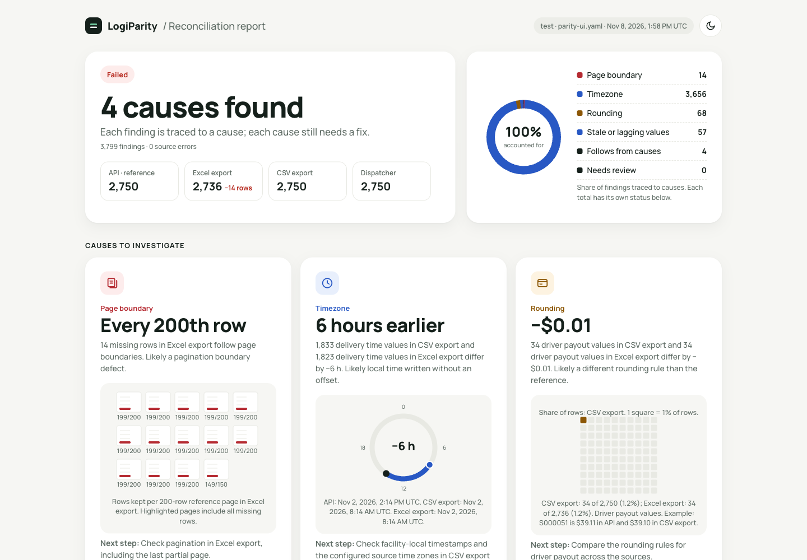
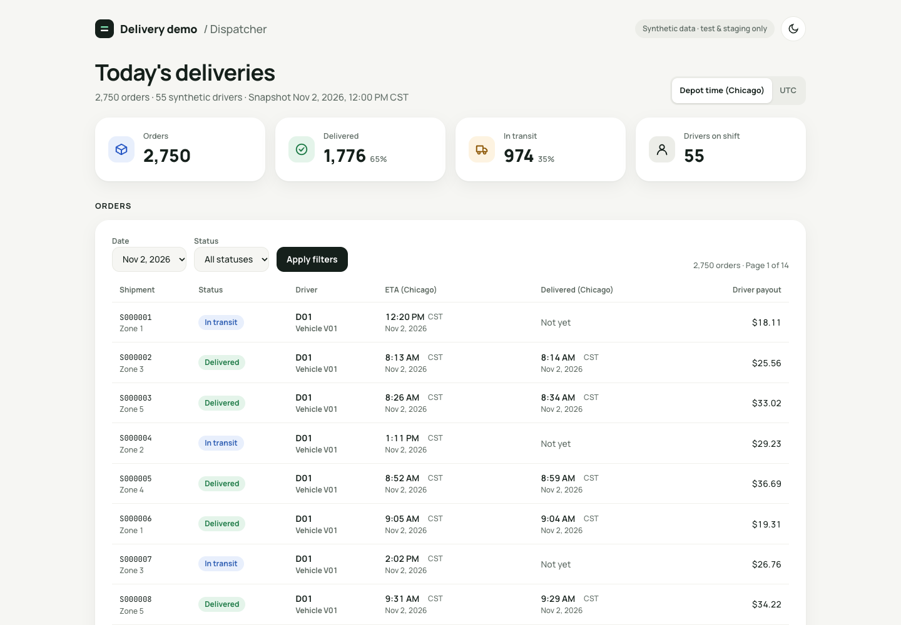
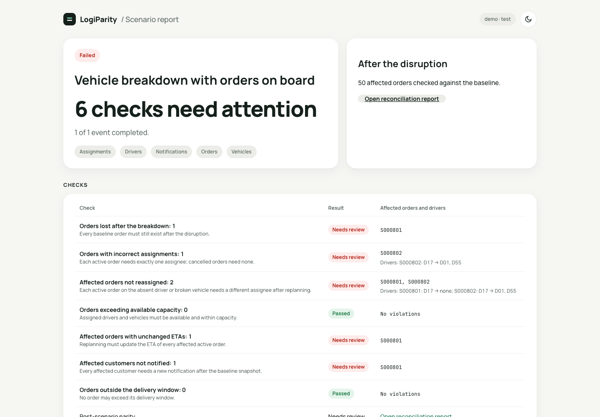

# LogiParity

Keyed data comparisons and disruption tests for logistics software.

The same shipment appears in an API, a dispatcher screen and an accounting export. A missing export row or a one-cent payout difference can survive ordinary endpoint tests. LogiParity compares these records by a shared key and identifies the affected records and fields.

## Why this matters

Delivery and freight systems move operational data between planning, dispatch and accounting. Each handoff can introduce a different defect:

- A payout or settlement rounds differently in the API and accounting export.
- The dispatcher screen keeps an old status after the backend updates it.
- Replanning after a breakdown drops an order or assigns it twice.
- An export loses a row at a page boundary.

An endpoint test can pass while another surface shows different records. A contract test can confirm the response shape without comparing the same day's data across those surfaces. Operational checks also need to verify what happens to affected orders after a disruption. The demo bugs are synthetic reproductions of these failure classes.

## How it differs from tools you already use

| Tool | Typical focus |
| --- | --- |
| [Postman](https://learning.postman.com/docs/tests-and-scripts/write-scripts/intro-to-scripts/) | API requests, scripts and automated API tests. |
| [Playwright](https://playwright.dev/docs/intro) | Browser automation and end-to-end application tests. |
| [Pact](https://docs.pact.io/) | Consumer and provider expectations at integration boundaries. |
| [Great Expectations](https://docs.greatexpectations.io/docs/core/introduction/) | Data validation through expectations and validation workflows. |
| [data-diff style tools](https://github.com/datafold/data-diff) | Record and value differences within or across database tables. |

LogiParity combines keyed record parity across UI, API, exports and SQL with exact money and timezone handling, plus disruption scenarios with operational invariants. YAML defines the sources, mappings, tolerances and failure rules. Reports connect each difference to its source, key and field.

## Quickstart

Use Node.js 20 or later; CI tests Node 20 and 22. The demo contains 55 synthetic drivers and 2,750 orders. No browser or database installation is needed for this first report.

```sh
git clone https://github.com/Nutts5796/logiparity.git
cd logiparity
npm ci --ignore-scripts
DEMO_PORT=3010 npm run demo
```

`DEMO_PORT` selects the local port. Keep that terminal open. In a second terminal, from `logiparity`:

```sh
export DEMO_API_URL=http://127.0.0.1:3010
npm run demo:export
./node_modules/.bin/logiparity check --config examples/demo/parity.yaml
```

Expected: zero findings and exit 0. Open `logiparity-report/report.html`. The same directory contains JSON, Markdown and JUnit reports. If you change the port, use the same value in `DEMO_API_URL`.

Stop the demo, run `DEMO_PORT=3010 npm run demo:bugs`, then repeat the export and check commands. The report finds missing rows, payout differences and shifted datetimes. Repeated patterns get one summary line each, for example "1,833 delivered_at values in csv differ by exactly -6h (likely timezone)", and every individual finding stays listed below.



<details><summary>Dispatcher screen</summary>



</details>

HTML and Markdown show currency values beside minor units, and ISO UTC beside epoch milliseconds. JSON retains normalized values and adds pattern groups without removing individual findings.

## Try it on your staging

Save this as `parity.yaml`. Set `STAGING_API_URL` and `STAGING_API_TOKEN` in your environment. Read the export and API at the same cutoff time. Alternatively, compare a closed day so in-flight updates do not become parity findings.

```yaml
version: 1
environment: staging
entities:
  - name: shipment
    key: id
    sources:
      api:
        type: rest
        baseUrl: ${STAGING_API_URL}
        path: /shipments
        auth: {type: bearer, tokenEnv: STAGING_API_TOKEN}
        pagination: {type: page, size: 25, totalPagesPath: $.pagination.totalPages}
        fields: {id: $.id, status: $.status, payout: $.payout}
      accounting:
        type: csv
        file: ./shipments.csv
        fields: {id: "Shipment ID", status: Status, payout: "Driver payout"}
    compare:
      status: {type: enum}
      payout: {type: money, currency: USD, allowNumber: true}
report:
  outputs: [console, html, json, markdown, junit]
  dir: ./logiparity-report
```

Match the paths, headers and pagination metadata to your API, then run `./node_modules/.bin/logiparity validate --config parity.yaml` to check the file without reading any source. `logiparity init` writes a commented starter config. `totalPagesPath` detects a server that caps pages below the requested size. `allowNumber` accepts numeric API payouts through their decimal string representation; decimal strings remain the safest money input. Read the [configuration reference](docs/configuration.md) for precision rules, SQL and browser sources.

This GitHub Actions job downloads the export and preserves reports after either kind of failure. Run shared staging checks manually or nightly; enable pull requests only with an isolated target.

```yaml
name: Staging parity
on:
  workflow_dispatch:
  schedule:
    - cron: '0 3 * * *'
permissions: {contents: read}
jobs:
  parity:
    runs-on: ubuntu-latest
    timeout-minutes: 15
    env:
      STAGING_API_URL: ${{ vars.STAGING_API_URL }}
      STAGING_API_TOKEN: ${{ secrets.STAGING_API_TOKEN }}
    steps:
      - uses: actions/checkout@3d3c42e5aac5ba805825da76410c181273ba90b1 # v7.0.1
      - uses: actions/setup-node@949feb2413d6458794dcd2491c4babbbce0c15c1 # v7.1.0
        with: {node-version: '22', cache: npm, cache-dependency-path: parity.yaml}
      - name: Verify and install the release
        run: |
          base=https://github.com/Nutts5796/logiparity/releases/download/v1.0.0
          curl --fail --silent --show-error --location "$base/logiparity-1.0.0.tgz" --output logiparity-1.0.0.tgz
          curl --fail --silent --show-error --location "$base/logiparity-1.0.0.tgz.sha256" --output logiparity-1.0.0.tgz.sha256
          sha256sum --check logiparity-1.0.0.tgz.sha256
          npm install --no-save --ignore-scripts ./logiparity-1.0.0.tgz
      - run: >-
          curl --fail --silent --show-error
          -H "Authorization: Bearer $STAGING_API_TOKEN"
          "$STAGING_API_URL/exports/shipments.csv" --output shipments.csv
      - name: Compare
        run: |
          set +e
          ./node_modules/.bin/logiparity check --config parity.yaml
          code=$?
          set -e
          if [ "$code" -eq 1 ]; then echo '::error::Data findings'; fi
          if [ "$code" -eq 2 ]; then echo '::error::Source or configuration error'; fi
          exit "$code"
      - uses: actions/upload-artifact@cf430e030ddbb5b0abf93d22962f4752f3646cd9 # v7.0.2
        if: always()
        with:
          name: parity-report
          path: logiparity-report/
```

The installation URL targets the v1.0.0 release asset. Until that asset is attached, use the source checkout above or a locally built tarball. Once npm publication is available, `npm install logiparity@1.0.0` is the registry option. The [CI guide](docs/ci.md) and [templates](templates/github-actions.yml) cover report retention, credentials and browser setup.

## Disruption scenarios

Run a disruption against the demo after starting it and setting `DEMO_API_URL`:

```sh
./node_modules/.bin/logiparity scenario run examples/demo/scenarios/02-vehicle-breakdown.yaml --target examples/demo/target.yaml
```

Five examples cover no-show, breakdown, traffic delay, cancellation and capacity reduction. Select the state needed by each check:

- Lost-order checks use orders; single assignment adds assignments.
- Capacity checks add drivers and vehicles.
- ETA and notification checks use affected-order state.

Wait for a configured completion source, use a fixed delay, or omit wait. The [scenario reference](docs/scenarios.md) lists exact dependencies and a bring-your-own-API example. The [freight example](examples/freight/README.md) compares load totals with rolled-up settlement lines.



## Safety

Test and staging only. Read-only except scenario events you map yourself. No telemetry. [Security details](SECURITY.md).

## Status

First public release, maintained by one author. Feedback and pilots welcome.

## About

Built by Sergei Orekhovskii, a QA engineer who previously ran transport logistics for a delivery service and worked in railway operations. Developed with AI coding assistants; design decisions, review and testing by the author. Read the [technical design decisions](docs/design-decisions.md).

## Reference

- [Configuration](docs/configuration.md), [scenarios](docs/scenarios.md) and [optional AI drafts](docs/ai.md)
- [Reports](docs/report-formats.md), [JSON schema](docs/report-schema.md) and [adapter development](docs/writing-adapters.md)
- [CI](docs/ci.md), [Docker](docs/docker.md), [FAQ](docs/faq.md) and [release guide](docs/release.md)
- [Dependencies](docs/dependencies.md), [audit notes](docs/dependency-audit.md) and [build history](docs/development/milestones.md)
- [Contributing](CONTRIBUTING.md), [code of conduct](CODE_OF_CONDUCT.md), [roadmap](docs/roadmap.md) and [changelog](CHANGELOG.md)

MIT © Sergei Orekhovskii.
