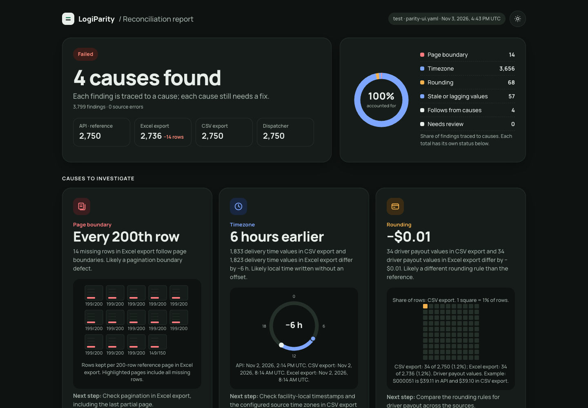
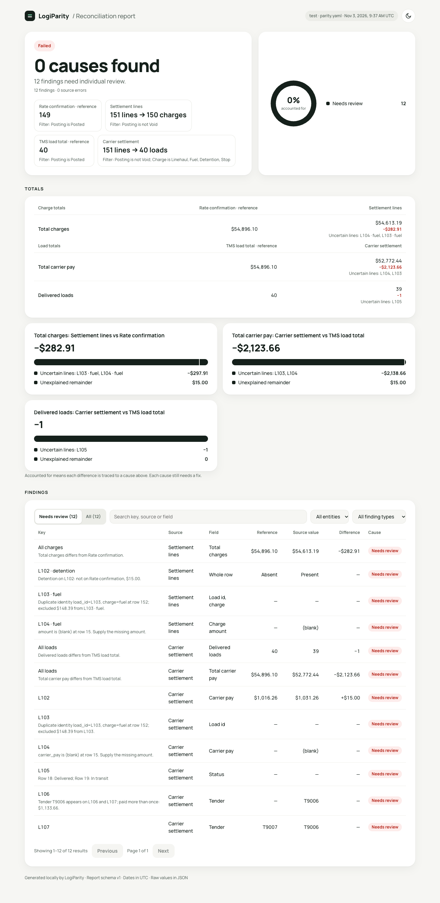

# LogiParity

The same shipment appears in an API, a dispatcher screen and an accounting export. A missing export row or a one-cent payout difference can survive ordinary endpoint tests. LogiParity compares the same records across those surfaces and checks orders after disruptions.

Keyed matching means joining records by a shared identifier, such as a shipment ID, regardless of row order. Composite keys can identify a load and its charge type together.

## Why this matters

Delivery and freight systems move operational data between planning, dispatch and accounting. Each handoff can introduce a different defect:

- A payout or settlement rounds differently in the API and accounting export.
- The dispatcher screen keeps an old status after the backend updates it.
- Replanning after a breakdown drops an order or assigns it twice.
- An export loses a row at a page boundary.

An endpoint test can pass while another surface shows different records. A contract test can confirm the response shape without comparing the same day's data across those surfaces. Operational checks also need to verify what happens to affected orders after a disruption. The demo bugs are synthetic reproductions of these failure classes.

## How it differs from tools you already use

| Tool                                                                                           | Typical focus                                                                            |
| ---------------------------------------------------------------------------------------------- | ---------------------------------------------------------------------------------------- |
| [Postman](https://learning.postman.com/docs/tests-and-scripts/write-scripts/intro-to-scripts/) | API requests, scripts and automated API tests.                                           |
| [Playwright](https://playwright.dev/docs/intro)                                                | Browser automation and end-to-end application tests.                                     |
| [Pact](https://docs.pact.io/)                                                                  | Consumer and provider expectations at integration boundaries.                            |
| [Great Expectations](https://docs.greatexpectations.io/docs/core/introduction/)                | Data validation through expectations and validation workflows.                           |
| [data-diff style tools](https://github.com/datafold/data-diff)                                 | Record and value differences within or across database tables.                           |
| **LogiParity**                                                                                 | Keyed comparisons across API, file, browser and SQL sources, plus disruption invariants. |

One configuration compares records across browser tables, APIs, files and SQL. Scenario runs add invariant checks after disruptions, such as whether every order remains present and has one assignment.

## Install

Use Node.js 22 or later. CI tests Node 22, 24 and 26.

```sh
npm install --save-dev --save-exact logiparity
npx logiparity --version
```

The default install supports CSV, XLSX and REST. Add only the adapters your configuration uses:

```sh
# Browser tables and the install-browser command:
npm install --save-dev --save-exact playwright@1.64.1
npx logiparity install-browser
# PostgreSQL:
npm install --save-dev --save-exact pg@8.23.1 pg-query-stream@4.17.1 pgsql-ast-parser@12.0.2
```

These are optional peers loaded only for UI or SQL configurations. Missing peers fail with exit 2 and the exact install command. External runtime dependencies are exact-pinned ordinary dependencies, so consumer `overrides` can patch them. See [dependencies and sizes](docs/dependencies.md) and the [offline kit](docs/release.md#offline-installation).

Version **1.1.0** adds the installed demo, optional browser parity and independent currency reconciliation.

## Quickstart

The installed package runs a synthetic delivery day with 55 drivers and 2,750 orders:

```sh
npx logiparity demo
```

Keep the service open. It creates `logiparity-demo/parity.yaml` without overwriting an existing file and prints these commands for a second terminal in the same project:

```sh
cd logiparity-demo
curl --max-time 60 --retry 3 --retry-connrefused -fsS http://127.0.0.1:3010/exports/shipments.xlsx -o shipments.xlsx
curl --max-time 60 --retry 3 --retry-connrefused -fsS http://127.0.0.1:3010/exports/shipments.csv -o shipments.csv
npx logiparity validate --config parity.yaml
npx logiparity check --config parity.yaml
```

Expected: zero findings, exit 0. Open `logiparity-demo/report/report.html` from the project directory. Stop the service, run `npx logiparity demo --bugs`, and repeat both downloads and the check. The report finds page-boundary losses, rounding differences and shifted datetimes. The three cause cards account for the money and count differences; each cause still needs a fix. JSON retains every normalized finding.

To include the dispatcher UI (optional), keep the demo running and use a second terminal from the project directory:

```sh
npm install --save-dev --save-exact playwright@1.64.1
npx logiparity install-browser
npx logiparity demo login
cd logiparity-demo
npx logiparity check --config parity-ui.yaml
```

The login command records a private synthetic session in `logiparity-demo/auth/state.json`; restart invalidates it. The generated directory ignores auth and reports. Download CSV/XLSX as above before the UI check. With `--bugs`, the UI adds the stale-status cause to the API/export checks. `demo login` uses the generated service marker, including its actual port.

For a source checkout:

```sh
git clone https://github.com/Nutts5796/logiparity.git
cd logiparity
npm ci
DEMO_PORT=3010 npm run demo
```

In another terminal, from `logiparity`:

```sh
export DEMO_API_URL=http://127.0.0.1:3010
npm run demo:export
npx logiparity validate --config examples/demo/parity.yaml
npx logiparity check --config examples/demo/parity.yaml
```

The checkout report is `logiparity-report/report.html`. Use `npm run demo:bugs` after stopping the service to enable the six synthetic defects. `DEMO_API_URL` configures checkout export/login scripts and the static checkout parity files. Installed scenario targets use the port recorded at generation time; restarting on a different port warns about each stale generated configuration. Move the generated demo directory aside to regenerate it, or edit the warned URLs explicitly. A source checkout currently reports moderate development-dependency advisories; see [dependency audit notes](docs/dependency-audit.md). Those development tools are excluded from the installed CLI.


<details><summary>Dark report</summary>



</details>

<details><summary>Dispatcher screen</summary>


</details>

HTML, Markdown and console reports show currency amounts and readable UTC dates, with a separate difference. JSON keeps the raw values. The offline HTML report groups causes, reconciles money totals and opens with the findings that need individual review.

## Try it on your staging

Save this as `parity.yaml`, or generate the identical starter with `npx logiparity init`. It works against the running demo without a token; change only `STAGING_API_URL` below to use a different demo port. For your own API, edit paths, mappings and completion metadata to match its contract. Uncomment bearer authentication if your staging API requires it and set `STAGING_API_TOKEN`.

```yaml
# LogiParity starter — TEST AND STAGING ENVIRONMENTS ONLY.
# First source is the reference. Paths resolve relative to this YAML file.
# Set STAGING_API_URL to your test/staging API, then edit path and fields.
# Keep secrets in environment variables; do not write credentials here.
version: 1
environment: test
publicEnv: [STAGING_API_URL]
entities:
  - name: shipment
    label: Order
    pluralLabel: orders
    key: shipment_id
    sources:
      api:
        label: API
        type: rest
        baseUrl: ${STAGING_API_URL}
        path: /api/shipments
        items: $.data[*]
        pagination: { type: page, totalPath: $.pagination.total, pageParam: page, sizeParam: limit, size: 200 }
        # auth: { type: bearer, tokenEnv: STAGING_API_TOKEN }
        fields: { shipment_id: $.id, status: $.status, payout: {path: $.driver_payout, label: Driver payout} }
      export:
        label: CSV export
        type: csv
        file: ./shipments.csv
        headerRow: 1
        fields: { shipment_id: "Shipment ID", status: Status, payout: "Driver payout" }
    compare:
      status: { type: enum, map: { Delivered: delivered, "In transit": in_transit } }
      # Money defaults to decimal strings; numeric input requires allowNumber: true.
      # Tolerance is in minor units.
      payout: { type: money, currency: USD, tolerance: 0 }
    aggregates:
      - { name: delivered_count, label: Delivered orders, type: count, where: { status: delivered } }
      - { name: payout_total, label: Total driver payout, type: sum, field: payout }
    # List: any finding in a selected category fails. [] is report-only.
    failOn: [missing, extra, mismatch, aggregate, duplicate, invalid]
    # Or use allowed counts: { missing: 2, mismatch: 10, aggregate: 0 }
    # Runtime/source errors always exit 2, regardless of failOn.
report:
  outputs: [console, html, junit, json, markdown]
  dir: ./logiparity-report
```

Download a current export, validate the configuration, then compare:

```sh
export STAGING_API_URL=http://127.0.0.1:3010
curl --max-time 60 --retry 3 --retry-connrefused -fsS "$STAGING_API_URL/exports/shipments.csv" --output shipments.csv
npx logiparity validate --config parity.yaml
npx logiparity check --config parity.yaml
```

Read the export and API at the same cutoff time: freeze a snapshot or pass the same `as_of` value to both requests if the target supports it. Downloading them one after another does not freeze changing data. Otherwise compare a closed day after updates have stopped. `totalPath` detects capped pages and confirms completion. Money uses decimal strings by default; opt into numeric input only after reviewing precision. The [configuration reference](docs/configuration.md) also covers SQL, browser sources and `validate --allow-missing-env` for CI lint steps without secrets.

The [GitHub Actions template](templates/github-actions.yml) installs a pinned CLI, downloads a staging export and retains reports for seven days. Tokens are scoped to the download and comparison steps. Shared staging checks run manually or nightly; enable pull requests only with an isolated target. A [container job](templates/github-actions-container.yml) and a [GitLab job](templates/gitlab-ci.yml) are also available.

## Disruption scenarios

Run a disruption against the installed demo after starting it:

```sh
npx logiparity scenario run logiparity-demo/scenarios/02-vehicle-breakdown.yaml --target logiparity-demo/target.yaml
```

Five examples cover no-show, breakdown, traffic delay, cancellation and capacity reduction. Run `logiparity scenario validate <scenario.yaml> --target <target.yaml>` before injecting events. `affected_reassigned` verifies that each affected active order acquired a different driver, and fails when a replan never ran. Select the state needed by each check:

- The lost-order check reads the order list. The single-assignment check also reads assignments.
- Capacity checks add drivers and vehicles.
- ETA and notification checks use affected-order state.

For asynchronous replanning, configure a completion signal before reading the final state. A fixed delay is also supported. Without a wait setting, the runner reads final state immediately after the events. The [scenario reference](docs/scenarios.md) lists exact dependencies and a bring-your-own-API example. The [freight example](examples/freight/README.md) compares load totals with rolled-up settlement lines.


## U.S. freight and delivery

The [synthetic freight day](examples/freight/README.md) covers carrier settlement, accessorials such as detention, duplicate tenders and charge-line reconciliation. Compare a closed day at one cutoff, configure explicit zones for DST and multi-timezone fleets, and map EDI 210/214 data exported as CSV to the same load keys. This is a CSV mapping approach, not a tested EDI example; LogiParity does not decode EDI messages.



## How it is tested

The automated suite passed 564 [unit](https://github.com/Nutts5796/logiparity/tree/main/tests/unit) and [adapter](https://github.com/Nutts5796/logiparity/tree/main/tests/adapters) tests. The 116 passing [end-to-end tests](https://github.com/Nutts5796/logiparity/tree/main/tests/e2e) exercise real Chromium, disposable PostgreSQL and synthetic HTTP services. Coverage includes core, adapters, scenarios and CLI; packages/ai is tested but excluded from this coverage figure. Unit/adapter line coverage is 91.84% (3,233/3,520), above the 80% gate: core 97.22%, adapters 90.93%, scenarios 82.29% and CLI 60.59%. Scenario runner.ts and CLI subprocess behavior are exercised by e2e and installed-package checks and do not increase unit-process coverage.

Installed-package checks cover both optional-peer profiles, public imports and declarations, installed demo/scenario commands and empty-cache offline installation. Six clean consumer profiles on npm 10.9.9 and 11.6.0 passed plain npm install, npm ci, npm audit and npm audit signatures, including coexistence with Playwright 1.63.0 and pg 8.16.0. The clean-source quickstart executed the README commands, including plain npm ci, and checked all report formats.

The seeded property-based test [filter-contributions.test.ts](https://github.com/Nutts5796/logiparity/blob/main/tests/unit/filter-contributions.test.ts) checks reconciliation while amounts and filter fields change independently. Regression cases include one-off differences that never become patterns, DST gaps and overlaps, capped pages, duplicate keys, source filters and currency partitions, XLSX amplification, temporary-file cleanup, path escape, redirect refusal and report symlinks. Tests and fixtures are synthetic; these results are not claims about production use. Live publication, Docker builds/image execution and real staging APIs are not tested by this review. Detailed commands and review limits are in the [milestone report](https://github.com/Nutts5796/logiparity/blob/main/docs/development/MILESTONE_REPORT.md).

## How it was built

AI coding agents generated the code, tests and documentation under the maintainer’s commit account. The maintainer wrote milestone specifications and acceptance criteria, triaged review rounds using simulated reviewer personas (AI agents), not human testers or users, verified fixes and chose the report design, including readable labels, dates and reconciliation instead of decorative charts. The first-person [origin stories](docs/design-decisions.md) are the maintainer’s own accounts. See the [build history](https://github.com/Nutts5796/logiparity/blob/main/docs/development/milestones.md) and the selected [variant E design reference](https://github.com/Nutts5796/logiparity/tree/main/docs/design), which is excluded from the npm package.

## Verify

After publication, verify the installed dependency signatures and release artifacts:

```sh
npm audit signatures
VERSION=$(node -p "require('./node_modules/logiparity/package.json').version")
gh release download "v$VERSION" --repo Nutts5796/logiparity --pattern "logiparity-$VERSION.tgz" --pattern "logiparity-$VERSION.tgz.sha256"
shasum -a 256 -c "logiparity-$VERSION.tgz.sha256"
gh attestation verify "logiparity-$VERSION.tgz" --repo Nutts5796/logiparity
# Set LOGIPARITY_IMAGE to the full verified reference in that release's notes:
# ghcr.io/nutts5796/logiparity:<version>-slim@sha256:<verified index digest>
docker buildx imagetools inspect "$LOGIPARITY_IMAGE"
gh attestation verify "oci://$LOGIPARITY_IMAGE" --repo Nutts5796/logiparity
docker run --rm "$LOGIPARITY_IMAGE" --version
```

Use the verified 1.1.0 digest in the release notes as a CI variable, then set the CI variable to the verified digest from the release notes; no source commit is required for variable-based templates. Do not combine a 1.0.0 image with a 1.1.0 CLI.

## Safety

Test and staging only. Read-only except scenario events you map yourself. No telemetry. [Security details](SECURITY.md).

## Status

Version 1.1.0 — 2026-11-04. Maintained by Sergei Orekhovskii.

Pilots and feedback: share a sanitized use case or defect through [Issues](https://github.com/Nutts5796/logiparity/issues).

## About

Sergei Orekhovskii, the maintainer, is a QA engineer who previously ran transport logistics for a delivery service. AI authorship is described above. Read the [technical design decisions](docs/design-decisions.md).

## Reference

- [Configuration](docs/configuration.md), [scenarios](docs/scenarios.md) and [optional AI drafts](docs/ai.md)
- [Reports](docs/report-formats.md), [JSON schema](docs/report-schema.md) and [adapter development](docs/writing-adapters.md)
- [CI](docs/ci.md), [Docker](docs/docker.md), [FAQ](docs/faq.md) and [release guide](docs/release.md)
- [Dependencies](docs/dependencies.md), [audit notes](docs/dependency-audit.md) and [build history](https://github.com/Nutts5796/logiparity/blob/main/docs/development/milestones.md)
- [Contributing](CONTRIBUTING.md), [code of conduct](CODE_OF_CONDUCT.md), [roadmap](docs/roadmap.md) and [changelog](CHANGELOG.md)

## Upgrading from 1.0.x

Node 22+ is required. UI/SQL adapters now use optional peers; install the adapters you need or use the matching full image. Playwright supports `>=1.63.0 <2.0.0` with a runtime check; tests cover 1.63.0 and 1.64.1. PostgreSQL peer ranges are listed in [dependencies](docs/dependencies.md).

Text `where` filters are case-insensitive by default; set source `caseSensitive: true` to retain exact matching. The first row of a duplicate key now counts once in totals. New resource defaults stop a source above 100,000 physical rows (`entities[].sources.<name>.maxRows`) or a report above 10,000 findings (`maxFindings`) with exit 2. Previously those inputs could finish with exit 0 or 1. Raise the relevant setting together with the Node heap, for example `NODE_OPTIONS=--max-old-space-size=6144`, after reviewing memory use. Invalid cells produce `invalid_value` findings in the new default `invalid` failOn category: add it to explicit lists to block bad cells. Fixtures must remain within the scenario directory tree, including symlinks; move a 1.0 `../fixtures` directory under the scenario directory. Mutation targets require `allowedHosts`. Every interpolated environment value is secret unless its name is in `publicEnv`. Money still rejects excess precision unless rounding is explicitly enabled.

The 21 former core helper exports are restored as deprecated aliases until 2.0, including SourceError, ConfigError and policy helpers; the complete list and retained type aliases are in [public API notes](docs/public-api.md#deprecated-compatibility-exports). Use the supported entry points when updating integrations.

MIT © Sergei Orekhovskii.
