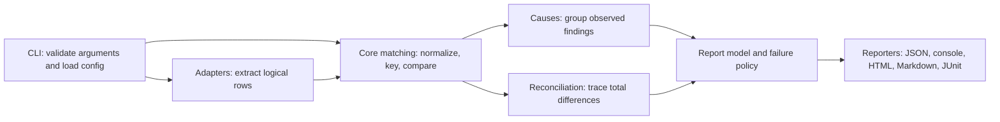

# Architecture and extension points

The engine compares logical records across sources; logistics lives in example packs and the synthetic demo, not in matching rules. Public imports are documented in [public-api.md](public-api.md). Source/lib implementation paths are internal; core's index and the three source compatibility re-exports retain existing callers.

This is the runtime flow, not an import graph. The configured first source is the reference. Source state retains row locations, keys, currencies, uncertainty and limits. Matching emits findings; cause membership and total attribution supplement them without removing evidence or changing configured blocking thresholds. Reporters render the resulting model; JSON preserves canonical units. CLI supplies adapter I/O, paths and environment, then writes reports. AI previews and scenario events are separate opt-in flows; scenarios can run parity afterward. The demo is a caller of the same contracts.

Core implementations live in eight concerns. `foundation` holds report contracts, keys, policy, diagnostics, host/file safety and limits. `values` holds normalization, calendar/money/number parsing, filters and decimal aggregation. `configuration` validates schemas and loads YAML/environment settings. `presentation` supplies labels and pure shared wording/value formatting used by diagnostics and causes as well as reports. `causes` groups supported observations. `reconciliation` attributes totals. `matching` reads source state and orchestrates comparison. `reporters` renders and writes output.

Runtime imports point from a higher concern to a lower one in [AGENTS.md](../AGENTS.md); same-concern imports are allowed. Pure type imports may cross concerns to describe contracts. `npm run check:architecture` enforces directions, rejects core imports of other workspace packages and prevents implementation logic from returning to the root compatibility entries. It is part of lint. This preserves the actual lower-level presentation dependencies used by cause summaries and source diagnostics rather than imposing an inaccurate “all formatting is top-level” rule.

Extension points: a field type starts in config plus normalization; a cause in groups plus report types, wording, chart and schema; a reporter in the reporters directory and writer routing; a source in the adapter registry implementing `Adapter.read`. Add offline fixture regressions for invalid inputs as well as happy paths. Exact locations and commands are in [AGENTS.md](../AGENTS.md). Custom scenario modules remain explicit trusted code; optional UI/SQL peers and AI providers stay lazy. Changes to public contracts, failure semantics, parsing defaults or schemas require deliberate feature review, never an incidental directory move.
