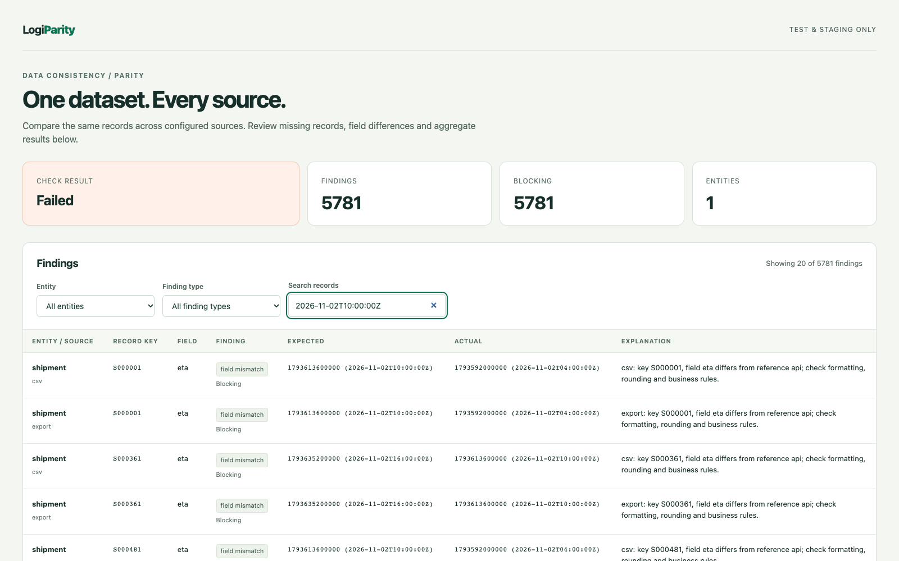

# Report formats (M3)

Select any subset of `console`, `html`, `junit`, `json`, `markdown` in `report.outputs`. Defaults remain console and JSON for M1 compatibility. The shipped demo and `logiparity init` example select all five. Paths are relative to `report.dir`; repeated outputs are written once. Console-only checks do not create a report directory. Write failures include the format/path and return exit 2.

| Output | Destination | Content |
| --- | --- | --- |
| console | stdout | Counts, blocking count, first ten findings. |
| html | report.html | Complete findings and aggregate values, entity/type filters and text search. |
| junit | junit.xml | One suite per entity and six cases per suite, one for each finding type. |
| json | report.json | Complete versioned machine-readable result. |
| markdown | report.md | Summary counts/aggregates and the first 50 findings for a merge request comment. |

## HTML

Open report.html locally in a browser. CSS and JavaScript are inline; there are no external fonts, CDNs, images or network requests. A Content Security Policy permits only the bundled hash-matched filter script and inline styles. Data values are escaped as text. Filters combine entity, finding type and case-insensitive text search; an empty-result message and live visible count describe the current view. Without JavaScript all rows remain readable. Narrow viewports scroll wide tables within their container.

UI read failures produce screenshots where a browser page is available. Optional findings[].screenshot values link to PNG/JPEG/WebP files under a relative screenshots/ directory. Schemes, traversal, control characters, queries, fragments and backslashes are rejected. Links do not load images automatically; preserve relative screenshot files when moving reports. Console-only output creates no report files, but UI failures may still save diagnostic screenshots.

## JUnit

Reports validate against the independently authored [Windy Road Apache Ant JUnit XSD](https://github.com/windyroad/JUnit-Schema), vendored unmodified under tests/fixtures/junit with its Apache-2.0 license and checksum. Tests invoke `xmllint --nonet --noout --schema` so validation requires no network. Install libxml2-utils on Debian/Ubuntu; CI does so explicitly.

Each entity has six cases, using the full finding type names. A case with no findings passes. Blocking ordinary findings produce one failure containing all finding details; source errors become errors. A case containing only nonblocking findings is skipped with an explanation, so CI does not present allowed discrepancies as executed passing checks. Suite counts count cases, not individual findings. A broken source is always an error even under `failOn: []`.

The strict Ant schema requires timestamp, hostname and timing fields. Timestamp is the actual generation time in UTC, recorded as a suite property. Hostname uses the portable `localhost` label. No per-case timing is measured: `time="0"` is a schema-required placeholder, explicitly declared in the `timing` property, and is not a performance measurement. Finding order and comparison values are deterministic; generation timestamps vary across runs.

XML markup is escaped and characters illegal in XML 1.0, including unpaired UTF-16 surrogates, are replaced with U+FFFD. JUnit includes all affected keys and values without truncation. JSON retains original scalar text.

## Markdown and JSON

Markdown escapes untrusted markup, links/images and table separators. It includes aggregate values and skipped source names; summaries over 50 findings explicitly state the omitted count. Select HTML or JSON as well for a complete finding list. LogiParity writes the comment text to a file and never posts it to another service.

JSON schema version remains 1: M2 adds optional `blocking`, `screenshot` and entity `aggregates` metadata, permitted by the v1 additive-field policy. Consumers should tolerate optional fields. See report-schema.md for units and structure.

## Monetary presentation (M3 owner addition)

HTML/Markdown display configured monetary fields and sum aggregates as `682625 ($6,826.25)`: integer minor units with a major-unit currency equivalent beside them. Currency/locale come from the entity's money rule; counts and non-money fields are never formatted as currency. Formatting uses bigint arithmetic and Intl parts, retaining large amounts and negative sub-unit signs without conversion through floating-point major amounts.

The CLI supplies `{entities: config.entities}` as separate presentation context. Library callers can pass that optional context to htmlReport, markdownReport or writeReports; absent metadata means minor units only, with no guessed currency. JSON data/schema/units remain unchanged, and no display/currency properties are attached to Report. Console/JUnit continue to use normalized minor units. Regression tests compare JSON byte-for-byte before/after rendering and writing the human-readable formats.

## M4 UTC presentation and scenario reports

Configured datetime fields in HTML/Markdown show both epoch milliseconds and ISO 8601 UTC: `1793624460000 (2026-11-02T13:01:00Z)`. Nonzero milliseconds are retained (`.123Z`); formatting does not use the machine timezone. JSON, console and JUnit comparison values remain unchanged. Renderer callers pass entity configuration as presentation context, as for currency; numeric fields are not guessed to be datetimes.

Scenario runs write `scenario.html`, `scenario.md`, `scenario.json` and `junit.xml`, with one result per invariant, explanations and affected keys. Optional post-scenario Parity writes the existing formats into `parity/`, linked from the scenario summary. See [scenario reference](scenarios.md).

